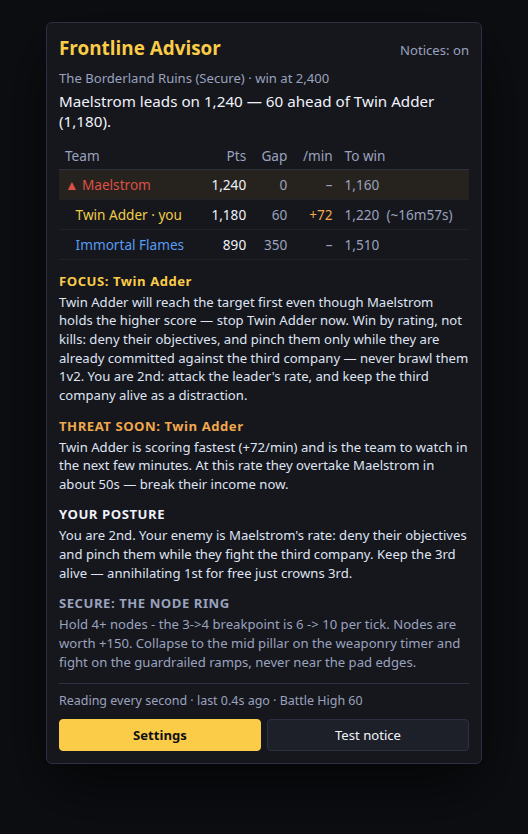
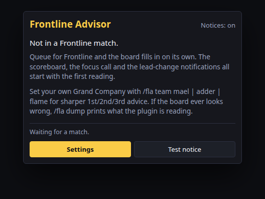
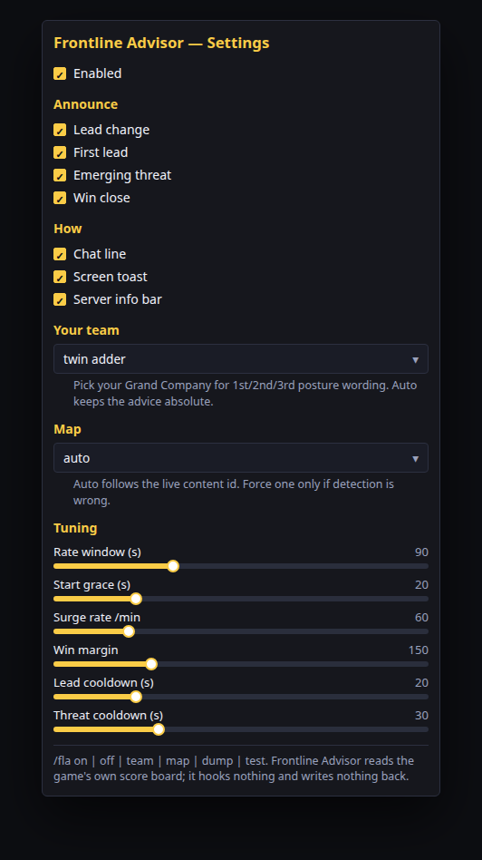
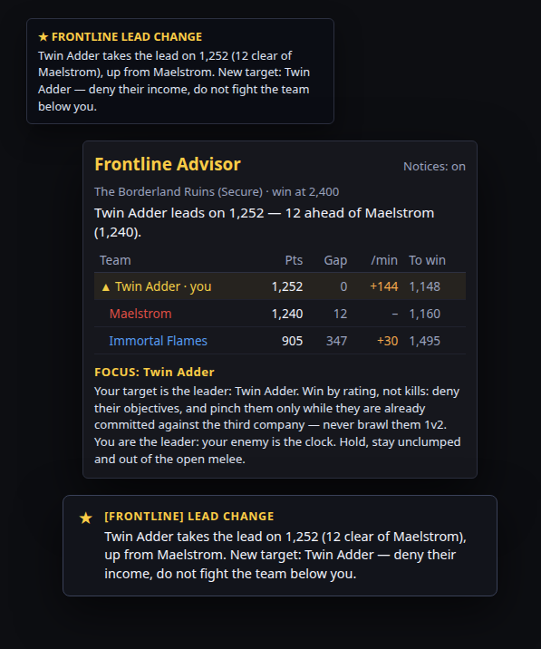

# Frontline Advisor

Reads the live Frontline scoreboard and says who is winning, who to focus, who is about to matter — and when the lead changes.

`/fla` · Dalamud API 15 · .NET 10

## What it does

- **Standings** — leader, gap to second, points left.
- **Focus** — the team closest to winning, and the doctrine for hitting them.
- **Threat** — the fastest scorer, and when they overtake.
- **Lead change** — chat line and toast when another company takes the lead.

Doctrine: play the leader, not the scoreboard; deny their rate; never fight the team just below you; your enemy is the clock, the rate, the stalemate.

## Screenshots

Simulated mocks, not client captures, built from `Core` on sample Secure scores. Gallery: [`preview.html`](preview.html). Sources: [`docs/screenshots/`](docs/screenshots/).

| Mid-match | Idle |
|---|---|
|  |  |

| Settings | Lead-change notice |
|---|---|
|  |  |

## How it works

Three scores live in the instance-content director, beside Battle High; read through `EventFramework.GetInstanceContentDirector()` and a **read-only** overlay struct:

| Offset from the director | Field |
|---|---|
| `+0x24D2` | Maelstrom score (short) |
| `+0x24F2` | Twin Adder score (short) |
| `+0x2512` | Immortal Flames score (short) |
| `+0x33B7` | your Battle High (byte) |

- **No hooks, no signatures, no writes.**
- Content id (`GameMain.CurrentContentFinderConditionId`) decides the map first, so Crystalline Conflict and Rival Wings — a different director layout — are never read.
- Scores are range-checked: a stale offset shows *no reading*, not a wrong number, plus a `/xllog` line; `/fla dump` prints live values so it can be re-derived in one match.
- Rate is a **least-squares slope over a trailing window** (90 s default), so one odd tick cannot fake a surge.

## Commands

| Command | Effect |
| --- | --- |
| `/fla` | Toggle the window. |
| `/fla on` / `/fla off` | Master notification switch. |
| `/fla team mael\|adder\|flame\|auto` | Your Grand Company: 1st/2nd/3rd posture wording. |
| `/fla map <name\|auto>` | Force a map if detection is wrong. |
| `/fla dump` | Print live content id, director pointer and raw scores to chat and `/xllog`. |
| `/fla test` | Fire a sample lead-change notice. |
| `/fla config` | Open settings. |

## Settings

- **Announce** — lead change, first lead, emerging threat, win close.
- **How** — chat line, screen toast, server info bar entry (the leader's score, shown only during a match).
- **Your team** — auto (absolute advice) or a Grand Company (sharper posture); **Map** — auto or forced.
- **Tuning** — rate window, start grace, surge threshold, win margin, the two cooldowns.

## Build

Requires the .NET 10 SDK and the Dalamud dev distribution (`%APPDATA%\XIVLauncher\addon\Hooks\dev`, or `DALAMUD_HOME`).

```
dotnet build -c Debug      # load bin/Debug/FrontlineAdvisor.dll as a dev plugin
dotnet build -c Release    # zip in bin/Release/FrontlineAdvisor/latest.zip
```

## Install (dev plugin)

1. `/xlsettings` → Experimental → Dev Plugin Locations → add `bin\Debug\FrontlineAdvisor.dll`.
2. `/xlplugins` → Dev Tools → enable **Frontline Advisor**.
3. `/fla` opens the window; `/fla config` opens settings.

## Tests

`tests/LogicTests` compiles the pure `Core/*.cs` with no Dalamud, dev distribution or game, and plays whole matches through the analyzer, advisor and tracker. CI runs it on every push and PR.

```
cd tests/LogicTests && dotnet run -c Release
# 75 passed, 0 failed
```

## Limits

- Offsets and content ids are pinned to the patch 7.5-era build; a PvP patch can move them. `/fla dump` spots and fixes it; the plugin degrades to "no reading" rather than guessing.
- The screenshots are simulated mocks: in-game rendering is not verified here.

## Layout

```
Core/                 analyzer, advisor, tracker, teams, maps
FrontlineDirector.cs  read-only overlay, defensive reader
Notifier.cs           chat line + toast
Configuration.cs      IPluginConfiguration
Windows/              window, settings
Plugin.cs             services, update loop, commands
preview.html          gallery
docs/screenshots/     mocks + PNGs
tests/LogicTests/     offline harness
```
